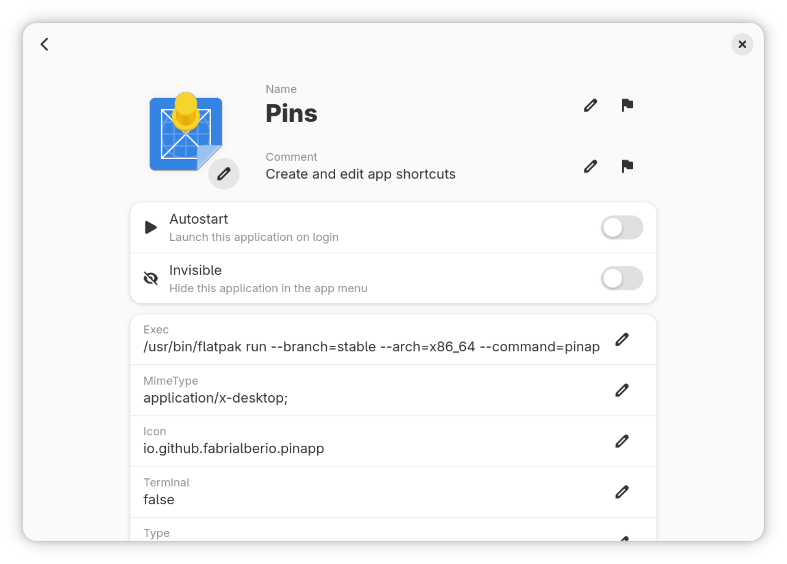

## Features
Pins allows you to customize your app menu by editing .desktop files.

Some of the things you can do are:
- changing an app icon that doesn't fit in with your theme;
- creating custom shortcuts to websites;
- hiding apps you don't want to see;
- ediying other properties in .desktop files.

## Installation

